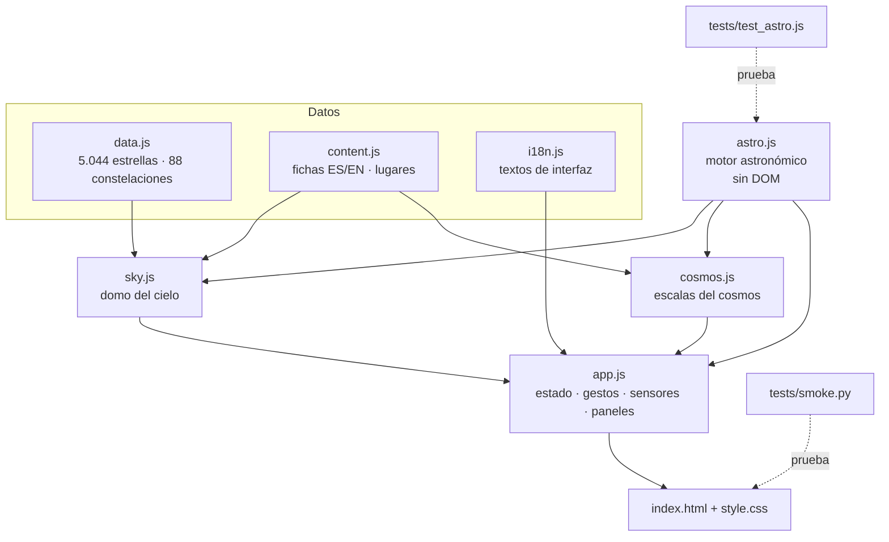
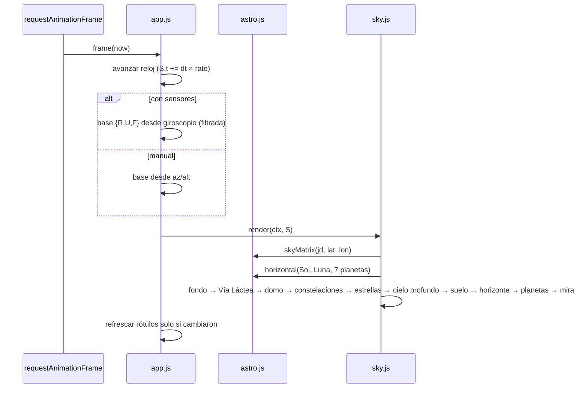

# Arquitectura

La app se escribe en módulos pequeños dentro de `App/fuente/src/` y `build.py` los une en un único `cielos-de-ovalle.html`. No hay servidor, empaquetador ni librerías.

## Módulos



| Archivo | Líneas | Responsabilidad | Depende de |
|---|---|---|---|
| `astro.js` | 381 | Tiempo, precesión, Sol, Luna, planetas, horizonte, salidas y puestas, fases | nada |
| `data.js` | generado | Catálogo compacto | nada |
| `content.js` | 280 | Fichas bilingües, lugares, objetos del modo Cosmos | nada |
| `i18n.js` | 137 | Textos de la interfaz | nada |
| `sky.js` | 687 | Proyección y dibujo del cielo, selección por toque | `astro`, `data`, `content` |
| `cosmos.js` | 350 | Escena 3D de escalas | `astro`, `content`, `sky` (fuentes) |
| `app.js` | 886 | Estado, gestos, sensores, cámara, paneles, bucle | todos |

`astro.js` no toca el navegador: por eso se puede probar en Node y reutilizar en otro proyecto (React, Base44, un bot).

## Estado
Un único objeto `S` en `app.js`:

```js
S = {
  lang, mode,                 // 'es'|'en' · 'sky'|'cosmos'
  site: { name, lat, lon },
  t, rate, live,              // reloj simulado (ms), velocidad, ¿en vivo?
  view: { az, alt, fov },     // hacia dónde mira la cámara virtual
  cam:  { R, U, F },          // base ortonormal [Este, Norte, Arriba]
  sensor, camera, camFov, azOffset,
  layers: { lines, conNames, starNames, grid, equ, mw, dso, pointer, ground, atm },
  magLimit, sel, red
}
```

Las preferencias se guardan en `localStorage` (clave `cielos-ovalle-v1`), dentro de `try/catch`: si el almacenamiento no está disponible la app funciona igual.

## Flujo de un cuadro



## Reglas que mantienen la app rápida
- En el bucle solo hay multiplicaciones de matrices y dibujo. Las búsquedas de salidas y puestas se ejecutan al abrir un panel.
- Las estrellas están ordenadas por brillo: el dibujo se corta en cuanto supera la magnitud límite.
- El DOM se actualiza solo cuando cambia el texto (se compara una clave antes de escribir).
- La densidad de píxeles se limita a 2× para no dibujar 9 veces más en pantallas 3×.

## Construcción y pruebas

```bash
cd App/fuente
python3 build.py                 # → dist/cielos-de-ovalle.html
node tests/test_astro.js         # motor contra PyEphem
python3 tests/smoke.py           # app en Chromium (requiere playwright)
python3 tools/check_dsos.py <carpeta_datos>   # coordenadas de cielo profundo
```

Detalle en [[Precisión y pruebas]] y [[Catálogo y datos]].

## Tamaño

| Parte | kB |
|---|---|
| Catálogo de estrellas y constelaciones | 142 |
| Contenido y textos | 52 |
| Código (motor, cielo, cosmos, app) | 127 |
| HTML y estilos | 20 |
| **Total** | **342** |

Ver también: [[Motor astronómico]] · [[Proyección y cámara]] · [[Sensores y realidad aumentada]] · [[Decisiones de diseño]]
