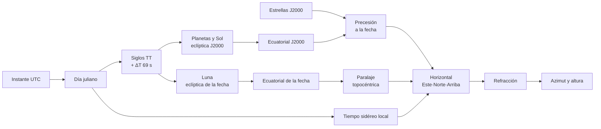

# Motor astronómico

`App/fuente/src/astro.js` — 381 líneas, sin dependencias. Entra un instante y un lugar; sale la dirección de cada astro en el cielo.

## Cadena de cálculo



## Piezas

### Tiempo
- **Día juliano** desde el reloj del sistema: `JD = ms / 86 400 000 + 2 440 587,5`.
- **ΔT** (tiempo terrestre menos universal): 69,2 s entre 2015 y 2035; fuera de ese rango, polinomio de Espenak y Meeus.
- **Tiempo sidéreo medio de Greenwich** (Meeus 12.4):
  `θ = 280,46061837 + 360,98564736629·(JD − 2451545) + 0,000387933·T² − T³/38 710 000`

### Planetas y Sol
Elementos keplerianos del JPL (E. M. Standish, *Keplerian Elements for Approximate Positions of the Major Planets*), válidos de 1800 a 2050: seis elementos y sus tasas por siglo para cada planeta.

1. Elementos en el instante `T`.
2. Ecuación de Kepler `M = E − e·sen E` por Newton-Raphson.
3. Posición en el plano orbital y rotación a la eclíptica J2000.
4. Vector geocéntrico = planeta − Tierra, con una iteración de **tiempo de luz**.
5. Rotación a ecuatorial (oblicuidad J2000) y **precesión** a la fecha.

El Sol es el vector Tierra con signo contrario: usa los mismos elementos, así que Sol y planetas son coherentes entre sí.

Magnitud visual con las fórmulas clásicas en función de las distancias y el ángulo de fase. No incluye el aporte de los anillos de Saturno.

### Luna
Meeus, capítulo 47: 39 términos en longitud y distancia, 29 en latitud, más las correcciones de Venus, Júpiter y el achatamiento. Después:
- paso a ecuatorial con la oblicuidad de la fecha;
- **paralaje**: se resta el vector del observador (radio terrestre / distancia lunar). Sin esto la Luna aparece hasta 1° corrida;
- fase a partir de la elongación real respecto del Sol.

### Estrellas y cielo profundo
Posiciones J2000 del catálogo convertidas una sola vez a vectores unitarios. En cada cuadro se multiplican por **una matriz 3×3**:

`M = L(tiempo sidéreo local, latitud) · P(precesión)`

`L` lleva de ecuatorial a horizontal con filas Este, Norte y Arriba.

### Refracción
Fórmula de Sæmundsson sobre la altura verdadera: `R = 1,02 / tan(h + 10,3/(h + 5,11))` minutos de arco. En el horizonte levanta los astros 0,48°. Se aplica a Sol, Luna y planetas.

### Salidas, puestas y culminación
Muestreo de la altura cada 6–8 minutos y bisección donde cambia de signo. Alturas de referencia: −0,833° para Sol y Luna (limbo superior y refracción), −0,567° para estrellas y planetas, −6°, −12° y −18° para los crepúsculos.

### Fases
`nextPhase` busca el cruce de la diferencia de longitudes Luna − Sol por 0°, 90°, 180° o 270°.

### Vía Láctea
Matriz galáctica→ecuatorial J2000 construida con el polo norte galáctico (AR 192,859°, Dec +27,128°). El centro galáctico cae en AR 266,405°, Dec −28,936° con 0,0002° de diferencia.

## Lo que no hace, a propósito
| Omisión | Efecto | Por qué se acepta |
|---|---|---|
| Nutación | 0,005° | Invisible a simple vista |
| Aberración anual | 0,006° | Ídem |
| Movimiento propio de estrellas | Alfa Centauri: 0,03° desde 2000 | Ídem |
| Refracción en estrellas | Hasta 0,5°, solo pegadas al horizonte | Costo por cuadro; documentado |
| Anillos en el brillo de Saturno | Hasta 1 magnitud | No cambia lo que se ve |
| Fuera de 1800–2050 | El error de planetas crece | Uso previsto: hoy y fechas cercanas |

## Uso desde otro proyecto

```js
const A = require('./astro.js');
const jd = A.jdFromMs(Date.now());
const ovalle = { lat: -30.6033, lon: -71.2003 };
const saturno = A.horizontal('saturn', jd, ovalle);
// { az, alt, altApp, ra, dec, dist, mag, ... }
const puestas = A.crossings(A.altOf('sun', ovalle), jd, 1, A.H0.sun);
```

Resultados de las pruebas: [[Precisión y pruebas]].
